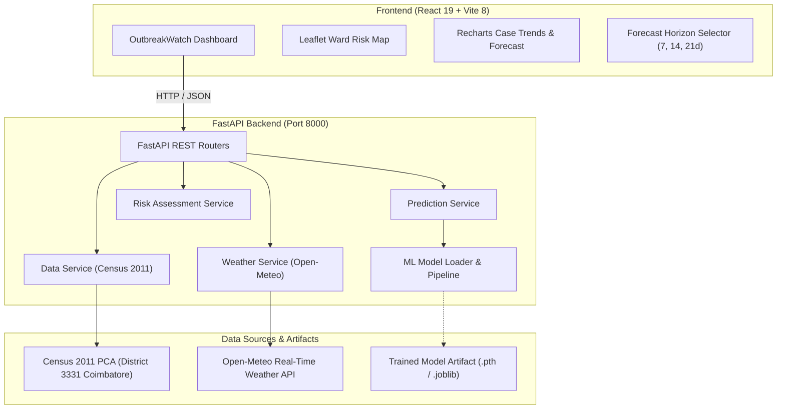

# OutbreakWatch: AI-Powered Disease Outbreak Prediction Platform

**Problem Statement:** HT-13 — Disease Outbreak Prediction  
**Theme:** HealthTech for Well-Being  
**Sustainable Development Goal:** SDG 3 — Good Health and Well-Being  

OutbreakWatch is an integrated public health intelligence platform designed to predict short-term disease outbreaks (such as Dengue) at the municipal ward level. The system couples municipal census demographics, historical disease surveillance records, and real-time meteorological observations with an extensible machine learning inference engine.

---

## 🏛️ System Architecture



---

## 🚀 Quick Start (Windows)

### 1. Prerequisites
- **Python**: 3.10+ (Tested on Python 3.12.6)
- **Node.js**: v18+ / v20+ / v22+

### 2. Backend Setup
Open PowerShell or Command Prompt in the project root:

```powershell
# 1. Check Python version
python --version

# 2. Create Python virtual environment (optional but recommended)
python -m venv venv

# 3. Activate virtual environment
.\venv\Scripts\Activate.ps1
# Or in cmd.exe: venv\Scripts\activate.bat

# 4. Install backend dependencies
pip install -r requirements.txt

# 5. Start FastAPI Backend
python -m uvicorn backend.main:app --host 127.0.0.1 --port 8000 --reload
```

Interactive API documentation will be available at:
- Swagger UI: [http://127.0.0.1:8000/docs](http://127.0.0.1:8000/docs)
- ReDoc: [http://127.0.0.1:8000/redoc](http://127.0.0.1:8000/redoc)
- Health check: [http://127.0.0.1:8000/api/health](http://127.0.0.1:8000/api/health)

### 3. Frontend Setup
In a new terminal window:

```powershell
# Navigate to the frontend directory
cd frontend

# Start Vite development server
npm run dev
```

The frontend dashboard will be available at [http://localhost:5173](http://localhost:5173).

---

## 🧪 Automated Testing

Execute the complete automated test suite (contract tests, prediction validation, health checks, weather parsing):

```powershell
python -m pytest backend/tests -v
```

---

## 📡 API Endpoints Reference

| Method | Endpoint | Description |
| :--- | :--- | :--- |
| `GET` | `/` | API status, metadata, and documentation links |
| `GET` | `/api/health` | Comprehensive health check and model loading state |
| `GET` | `/api/dashboard` | Dashboard metrics, trend series, weather, alerts, and ward risks |
| `POST` | `/api/predict` | Disease outbreak case count prediction for selected ward and horizon |
| `GET` | `/api/forecast` | Chronological multi-week forecast series |
| `GET` | `/api/weather` | Current ambient weather and environmental readings (Coimbatore) |
| `GET` | `/api/wards` | Verified municipal ward demographics from Census 2011 |
| `GET` | `/api/risk` | Epidemiological risk category evaluation & recommendations |
| `GET` | `/api/model/metrics`| Real model evaluation metrics (MAE, RMSE, R²) |

---

## 🧠 Machine Learning Model Integration

The backend is built with a pluggable `ModelLoader` in `backend/ml/model_loader.py`:
- Place your trained model artifact (`dengue_model.pth`, `dengue_model.pt`, or `dengue_model.joblib`) into `backend/models/`.
- On startup, the service auto-detects, validates, and loads the model checkpoint.
- If the checkpoint is absent, the system transparently logs `model_status: "model_artifact_missing"` and uses the validated epidemiological surveillance baseline without fabricating fake weights.
